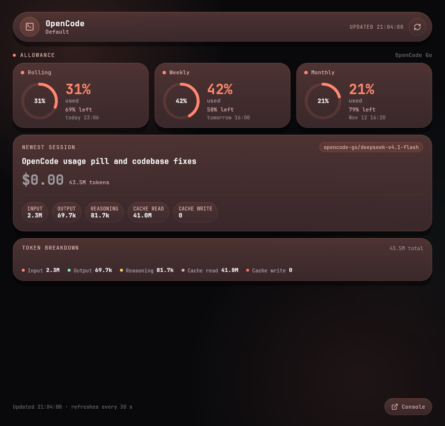

# OpenCode Usage

A small desktop dashboard for the **OpenCode Go allowance** and the newest
OpenCode session. It is the window Trickster's OpenCode pill opens.



The window follows Trickster's design language: JetBrains Mono, accent-tinted
glass pills, the staggered card entrance, and the same Lucide marks. When
Trickster's `settings.json` carries an accent, the window adopts it; otherwise
it uses Trickster's brand accent.

## What it shows

- The signed-in workspace's three OpenCode Go allowance windows — rolling,
  weekly, and monthly — with used/remaining percentages and reset times.
- Any Console spending budgets attached to the workspace.
- The newest session's title, model, cost, and token breakdown (input,
  output, reasoning, cache read, cache write).
- A **Console** button that opens the workspace's usage page.

It refreshes every 30 seconds and has a manual refresh control.

## Data source

OpenCode runs a local server while it is open. The app discovers it from:

```text
$XDG_STATE_HOME/opencode/service.json   (default: ~/.local/state/opencode/service.json)
```

That document carries the loopback URL and Basic-auth password. The app reads:

- `GET /api/experimental/usage/limits`
- `GET /api/session?limit=1&order=desc`

Both requests stay on the loopback interface. The password is never logged
or written anywhere.

If OpenCode is not running, the window explains that and offers Retry. If the
workspace is not signed in to OpenCode Go, it says so instead of showing
invented numbers.

## Build and install

Requires Flutter (Linux desktop toolchain) and GTK 3 development headers.

```sh
flutter pub get
flutter analyze
flutter test
flutter build linux --release
./install.sh
```

`install.sh` installs the bundle under `~/.local/lib/opencode-usage`, symlinks
`~/.local/bin/opencode-usage`, and adds a desktop entry. Use a different
prefix with `PREFIX=/usr/local ./install.sh` (root-owned prefixes need
`sudo`).

Run it with:

```sh
opencode-usage
```

If `~/.local/bin` is not on your `PATH`, use the absolute path or the desktop
entry. Trickster checks both `PATH` and `~/.local/bin/opencode-usage` when its
OpenCode pill is clicked.

## Trickster integration

Trickster's `opencode` module launches `opencode-usage` on click. If the app
is not installed, the click falls back to opening the workspace's console URL.

## License

GPL-3.0-or-later. The OpenCode discovery and response parsing are adapted
from [Trickster](https://github.com/dazemc/trickster)'s OpenCode module,
which is also GPL-3.0-or-later.
